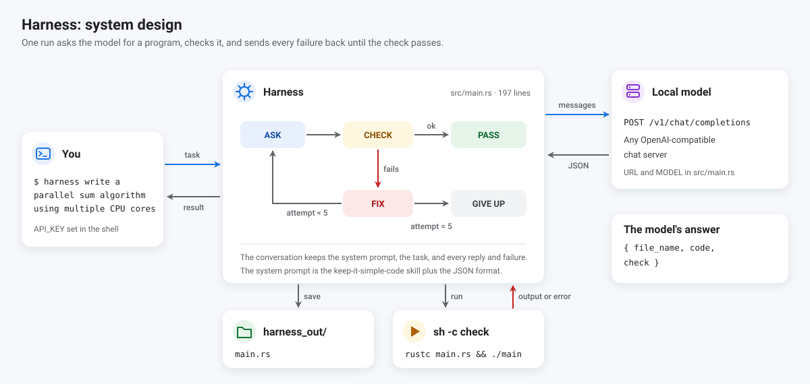
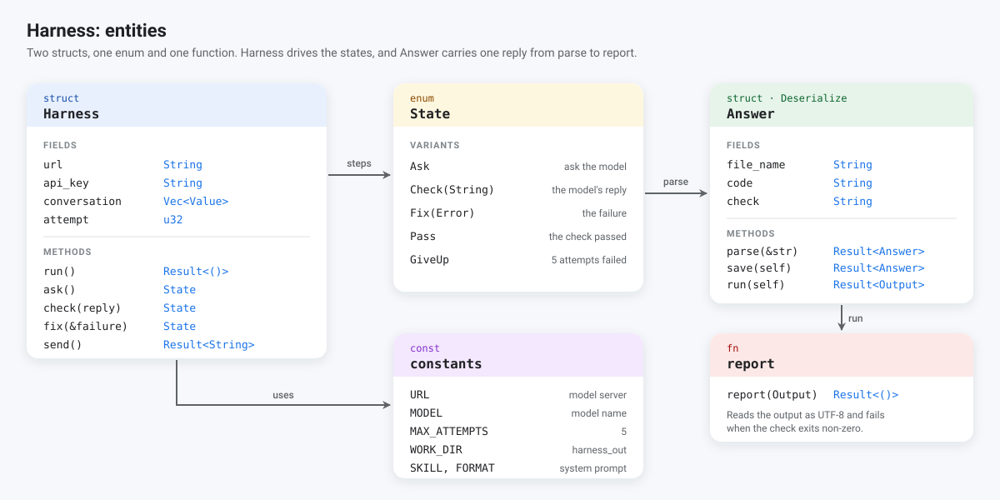
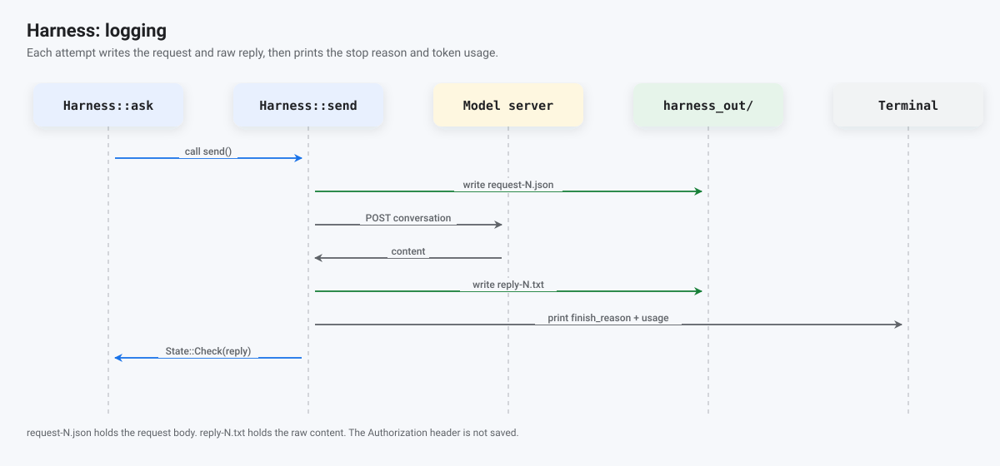

# Harness

`harness` sends a task in plain English to an OpenAI-compatible model. A reply contains a file
name, a program, and a shell command that checks the program.

We save each program in `harness_out/`, run its check in a sandbox, and send failures back to
the model, for up to 5 attempts. Each program must assert its own result, so a wrong answer fails
its own check.





## Run a task

```sh
cd harness
export API_KEY=...
cargo run --release -- "Write exactly five isolated functions that demonstrate mem::replace, mem::take, Option::take, mem::swap, and mem::forget. Keep the file under 80 lines and assert every result."
```

Every argument after the program name forms the task, joined with spaces. With `cargo run`,
`--` separates Cargo's arguments from that task.

`harness` reads `URL` and `MODEL` from `src/main.rs` and reads the key from `API_KEY`.

After one build, we can run the binary without Cargo:

```sh
./target/release/harness "your task"
```

## Sandbox

We treat the check command as untrusted, because the model writes it and a prompt injection can
turn it into any command `sh` can run. In `src/sandbox.rs`, we start each check through 3
standard tools.

```text
timeout --kill-after=5 120  prlimit --cpu=60 --as=4GiB --fsize=64MiB --nofile=256  bwrap ...  sh -c CHECK
```

With `bwrap` (bubblewrap), we create new user, mount, PID, network, IPC and UTS namespaces and
mount the following inside them.

- `/usr`, `/etc/alternatives`, `/etc/ld.so.cache`, `~/.rustup` and `~/.cargo/bin`, read-only.
- The program at `/work/main.rs`, read-only.
- `/work` and `/tmp` as empty tmpfs mounts. We discard both when the check exits, so a build
  output or a deleted file never reaches `harness_out/`.
- A fresh `/proc` for the new PID namespace, in which bwrap is process 1. When bwrap exits,
  the kernel ends every process in the namespace.

The network namespace has only a loopback interface. We clear the environment and set only
`PATH`, `HOME=/work` and `RUSTUP_HOME`, so `API_KEY` stays outside the sandbox.

Before we write a file, we reject a `file_name` that contains a directory, such as
`../../.bashrc`.

At startup, we run `true` in the sandbox. If it fails, we stop before the first request to the
model. On Ubuntu 24.04, for example, `kernel.apparmor_restrict_unprivileged_userns = 1` removes
the capabilities bwrap needs inside a new user namespace, and we print

```text
Error: the sandbox cannot start on this host: bwrap: loopback: Failed RTM_NEWADDR: Operation not permitted
```

We have not closed these gaps.

- We load no seccomp filter, so a kernel bug reachable from a user namespace stays reachable.
- We set no limit on the number of processes. `RLIMIT_NPROC` counts every process of the user
  on the whole machine, so only the 120-second timeout ends a fork bomb.
- We set no limit on the total size of `/work`. With `--fsize`, we cap each file at 64 MiB,
  and tmpfs uses RAM.
- We send the check output back to the model unchanged, so a program can print instructions
  for the next attempt.
- A check that prints `ok` and exits 0 passes. The sandbox limits which files, processes and
  networks a check can reach, and the model still decides what the check tests.

On a Jetson Orin NX with Linux 5.15, the sandbox added about 12 ms to each check. An empty
check took 17 ms in the sandbox and 5 ms without it (mean of 50 runs). The sample check
`rustc main.rs && ./main` took 361 ms in the sandbox and 362 ms without it (mean of 10 runs).

## Logs



Each attempt writes two files to `harness_out/`:

- `request-N.json` holds the request body. That body contains the model, messages, and temperature.

- `reply-N.txt` holds the raw reply text, exactly as the server returned it.

`harness` prints `finish_reason` and token usage for each reply. `finish_reason: stop` means
the model finished. `finish_reason: length` means the server stopped at its output limit.

A cut reply usually fails JSON parsing with `EOF while parsing a string`.

`harness` prints the reply path before it parses the reply. The API key stays in the
`Authorization` header and never enters either file.

## Example run

We ran this task against `Qwen3.6-35B-A3B-NVFP4`:

```text
Write a rust program that demonstrate std::mem::replace, replace, take,
std::mem::take and all memory management methods for interview data structire
and algoritjm idiomatic code. Keep each demo in isolated methods
```

Our first logged run failed on all 5 attempts. Each reply stopped inside the `code` string.
Reply 1 was 6469 bytes and ended at `vec![1, 2, 3`; the next three were 6371 bytes and the
last was 6071 bytes.

`serde_json` reported `EOF while parsing a string`, because the closing quote and JSON braces
never arrived. The task asked for "all memory management methods," so the model wrote a long
program and reached the output limit.

A later run of the same task passed on attempt 1. That reply was 5058 bytes,
`finish_reason` was `stop`, and `usage` reported 1426 completion tokens.

The model chose this check command:

```sh
rustc main.rs && ./main
```

The program printed:

```text
mem_replace: old=old, new=new
mem_take: taken_len=2, current_len=0
option_take: extracted=Some(42), current=None
vec_drain: drained_len=5, current_len=0
mem_swap: a=beta, b=alpha
mem_forget: value leaked (not accessible)
mem_size_of: size=8, align=8
mem_drop: new_data_len=3
All demonstrations completed successfully.
```

The files in [`examples/mem_patterns/`](examples/mem_patterns/) are a cleaned copy of this run.

### Raw reply

`reply-1.txt` holds the model's content, including the code fence. The reply starts with a JSON
object, and the `code` field is one long string with escaped newlines.

````text
```json
{
  "file_name": "main.rs",
  "code": "use std::collections::VecDeque;\n\nuse std::mem;\n\n...",
  "check": "rustc main.rs && ./main"
}
```
````

The middle of the `code` string is omitted in this excerpt. The HTTP response wraps this text in
`choices[0].message.content`. The tool reads that field and prints
`choices[0].finish_reason` and `usage`:

```text
finish_reason: stop, usage: {"completion_tokens":1426,"prompt_tokens":3176,"total_tokens":4602}
```

## Generated program

The listing below is the `code` field from `reply-1.txt`. Each demonstration is a separate
function, and `main` calls them in order.

```rust
use std::collections::VecDeque;
use std::mem;

/// Demonstrates std::mem::replace.
/// Swaps the value of a variable with a new value, returning the old value.
/// This is useful for implementing "swap-in" logic without needing a temporary variable.
fn demo_mem_replace() {
    let mut current_value = String::from("old");

    // Replace the current value with a new one.
    // The old value is returned and can be used or discarded.
    let old_value = mem::replace(&mut current_value, String::from("new"));

    assert_eq!(current_value, "new");
    assert_eq!(old_value, "old");

    println!("mem_replace: old={}, new={}", old_value, current_value);
}

/// Demonstrates std::mem::take.
/// A shorthand for mem::replace with the default value of the type.
/// This is particularly useful for clearing vectors, strings, or options.
fn demo_mem_take() {
    let mut buffer = Vec::with_capacity(10);
    buffer.push(1);
    buffer.push(2);

    // Take the current value and replace it with Vec::default() (empty vec).
    let taken_buffer = mem::take(&mut buffer);

    assert!(buffer.is_empty());
    assert_eq!(taken_buffer.len(), 2);

    println!("mem_take: taken_len={}, current_len={}", taken_buffer.len(), buffer.len());
}

/// Demonstrates Option::take.
/// Replaces the Option with None and returns the previous value.
/// Commonly used in iterators or when consuming an option once.
fn demo_option_take() {
    let mut optional_value = Some(42);

    // Take the value out, leaving None in its place.
    let extracted = optional_value.take();

    assert_eq!(extracted, Some(42));
    assert!(optional_value.is_none());

    println!("option_take: extracted={:?}, current={:?}", extracted, optional_value);
}

/// Demonstrates Vec::drain or clearing via replace.
/// Shows how to efficiently clear a collection by replacing it with a new empty one,
/// or using drain if you need to iterate over removed items.
fn demo_vec_drain_and_replace() {
    let mut queue: VecDeque<i32> = VecDeque::from(vec![1, 2, 3, 4, 5]);

    // Drain returns an iterator over the removed items.
    let drained: Vec<i32> = queue.drain(..).collect();

    assert!(queue.is_empty());
    assert_eq!(drained, vec![1, 2, 3, 4, 5]);

    println!("vec_drain: drained_len={}, current_len={}", drained.len(), queue.len());
}

/// Demonstrates std::mem::swap.
/// Swaps the values of two variables. This is atomic and safe.
/// Useful for implementing "ping-pong" buffers or swapping internal state.
fn demo_mem_swap() {
    let mut a = String::from("alpha");
    let mut b = String::from("beta");

    mem::swap(&mut a, &mut b);

    assert_eq!(a, "beta");
    assert_eq!(b, "alpha");

    println!("mem_swap: a={}, b={}", a, b);
}

/// Demonstrates std::mem::forget.
/// Prevents the destructor from running. This is dangerous and should
/// only be used when you explicitly want to leak memory or when
/// the destructor is unnecessary (e.g., raw pointers).
/// In this demo, we leak a Box to show the concept, but in real code,
/// this is rare. We use it here to demonstrate the API safely.
fn demo_mem_forget() {
    let leaked_box = Box::new(42);

    // Forget prevents the destructor from running.
    // The memory is leaked, but the value remains valid in memory.
    mem::forget(leaked_box);

    // We cannot access the value anymore, but it exists.
    // In a real scenario, this might be used with raw pointers or FFI.
    println!("mem_forget: value leaked (not accessible)");
}

/// Demonstrates std::mem::size_of and std::mem::align_of.
/// Useful for understanding memory layout, especially for FFI or custom allocators.
fn demo_mem_size_of() {
    let size = mem::size_of::<u64>();
    let align = mem::align_of::<u64>();

    assert_eq!(size, 8);
    assert_eq!(align, 8);

    println!("mem_size_of: size={}, align={}", size, align);
}

/// Demonstrates std::mem::drop.
/// Explicitly drops a value before the end of its scope.
/// Useful for holding a lock or resource longer than necessary,
/// or for moving a value into a drop guard.
fn demo_mem_drop() {
    let mut data = vec![1, 2, 3];

    // Drop the vector early to free memory before the end of the function.
    drop(data);

    // data is no longer accessible here.
    // We can create a new vector.
    let data = vec![4, 5, 6];

    assert_eq!(data.len(), 3);

    println!("mem_drop: new_data_len={}", data.len());
}

/// Main function to run all demonstrations.
/// Each demo is isolated in its own function to demonstrate idiomatic usage.
fn main() {
    demo_mem_replace();
    demo_mem_take();
    demo_option_take();
    demo_vec_drain_and_replace();
    demo_mem_swap();
    demo_mem_forget();
    demo_mem_size_of();
    demo_mem_drop();

    println!("All demonstrations completed successfully.");
}
```

This generated file compiles with an `unused_mut` warning in `demo_mem_drop`. The code declares
`data` as `mut` and then passes it to `drop`. The check still passes.

The comments come from the model. Its `mem::swap` comment calls the operation "atomic."
`std::mem::swap` is safe and in-place. `std::mem::swap` is not atomic with respect to other
threads.

## Inspect a run

```sh
cd harness
less harness_out/reply-1.txt
jq '.messages | length' harness_out/request-1.json
sed '1d;$d' harness_out/reply-1.txt | jq -r '.code'
```

`reply-N.txt` includes the code fence from the model. The parser strips that fence before
reading JSON. When a reply is cut off, `reply-N.txt` shows the last bytes from the server and
`finish_reason` shows `length`.

## When the model writes too much

`harness` retries a failed check. A model that reaches the output limit often writes the same
long answer again.

Narrow the task or split it. A task that asks for five short demonstrations is more likely to
finish than one that asks for "all memory management methods."

## Tests

```sh
cargo test --release
```

We run 14 tests, some against a fake model server on localhost. They cover parsing, saving,
check failures and the retry loop. In 5 of them, we attempt to escape the sandbox. We use a
`../` file name, write a file that must disappear, overwrite the read-only program, read the
host's files and environment, and list the network interfaces.
